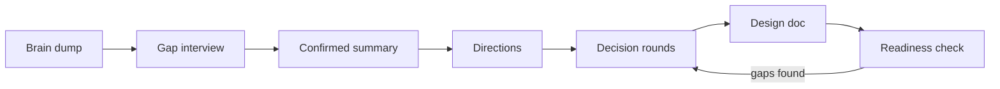

# Skills

Claude skills for planning and building projects with AI, written so the AI asks before it assumes.

## Skills

| Skill | What it does | Status |
|---|---|---|
| [idea-to-spec](skills/idea-to-spec/SKILL.md) | Takes a rough project idea to a design doc you can build from: short interview, an expert council that checks against your vision, and small decision rounds. | Draft, untested |

## idea-to-spec at a glance



- **Understands before it suggests.** No ideas until you have confirmed its summary of your problem, with its guesses marked as guesses.
- **Small rounds.** At most 3 questions per message, each with context, expert perspectives, options with trade-offs and a recommendation.
- **Silence is not agreement.** Anything you don't answer stays open and comes back.
- **The council finds problems, you choose solutions.** Ten expert roles (UX, architecture, red team, scope and more) raise issues, but every option has to fit your goals and avoid your don't-wants.
- **Clean output.** The doc is written only from agreed decisions, follows strict writing rules and is checked by a fresh reader who has never seen the conversation.
- **Resumable.** A decision list keeps the state, so you can continue in a new chat.

Works best in the Claude app with subagents available. Also runs in Claude Code.

## Install

**Claude app (web, desktop, mobile)**

1. Run `scripts/package.sh idea-to-spec`. This writes `dist/idea-to-spec.zip`.
2. In Claude, open Customize > Skills, choose "Create skill", then "Upload a skill", and pick the ZIP.

Once uploaded, the skill is available in every chat, including on your phone.

**Claude Code**

Copy or symlink the skill folder:

```sh
ln -s "$PWD/skills/idea-to-spec" ~/.claude/skills/idea-to-spec      # all projects
ln -s "$PWD/skills/idea-to-spec" .claude/skills/idea-to-spec        # one project
```

## Layout

```
skills/
  idea-to-spec/
    SKILL.md              process and rules
    council/              one file per expert role, shared rules, prompts
    templates/            decision list, design doc sections
    references/           writing rules, example turns
scripts/
  package.sh              builds upload ZIPs into dist/
CLAUDE.md                 conventions for working on this repo with Claude
```

## Adding a skill

1. Create `skills/<name>/SKILL.md` with `name` and `description` in the frontmatter.
2. Keep SKILL.md to the process. Put detail in subfolders and say in SKILL.md when to read them.
3. Add a row to the table above.
4. Package with `scripts/package.sh <name>` and test it in a real conversation before marking it ready.

## Credits

The council roles in idea-to-spec are adapted from [agentic-council](https://github.com/dtsong/agentic-council) (Apache License 2.0). See [the notice](skills/idea-to-spec/council/NOTICE.md) for what changed.

## License

MIT, see [LICENSE](LICENSE). The council role files in `skills/idea-to-spec/council/` stay under the Apache License 2.0, as stated in their notice.
